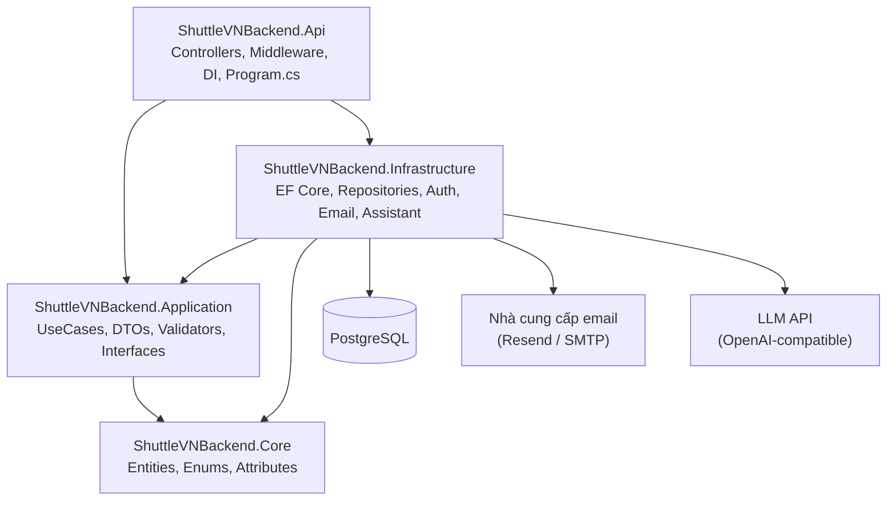
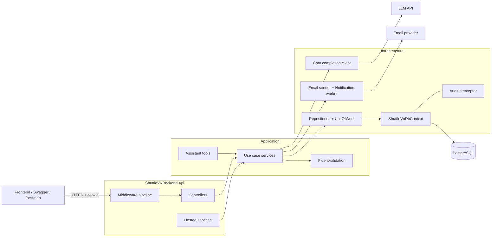
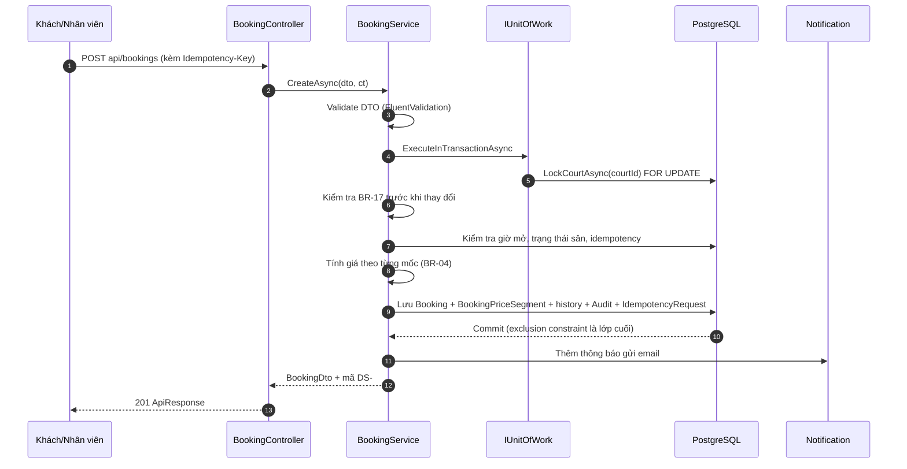

# Kiến trúc hệ thống — ShuttleVN

**Phiên bản 1.0 · 31/10/2026**

Căn cứ: `SRS.md` 2.0, `UseCase.md` 2.0, `database.md` 2.2 và mã nguồn `ShuttleVNBackend`.
Tài liệu này mô tả kiến trúc triển khai thực tế của backend. Quy tắc nghiệp vụ (BR-xx) và
yêu cầu chức năng (FR/NFR) thuộc SRS; cấu trúc dữ liệu chi tiết thuộc `database.md`.

## Mục lục

1. [Tổng quan và phạm vi](#1-tổng-quan-và-phạm-vi)
2. [Kiến trúc phân lớp](#2-kiến-trúc-phân-lớp)
3. [Thành phần thời gian chạy](#3-thành-phần-thời-gian-chạy)
4. [Luồng nghiệp vụ chính](#4-luồng-nghiệp-vụ-chính)
5. [Dữ liệu và ranh giới giao dịch](#5-dữ-liệu-và-ranh-giới-giao-dịch)
6. [Bảo mật](#6-bảo-mật)
7. [Tích hợp ngoài](#7-tích-hợp-ngoài)
8. [Cấu hình và triển khai](#8-cấu-hình-và-triển-khai)
9. [Kiểm thử và vận hành](#9-kiểm-thử-và-vận-hành)
10. [Thay đổi tài liệu](#10-thay-đổi-tài-liệu)

## 1. Tổng quan và phạm vi

ShuttleVN là hệ thống quản lý và đặt sân cầu lông cho **một cơ sở duy nhất**, kèm trợ lý AI tư vấn.

| Vai trò | Phạm vi chính |
| --- | --- |
| Khách vãng lai | Xem sân, lưới sân, đơn giá; đặt nhanh có xác minh email; dùng trợ lý AI; thiết lập mật khẩu. |
| Khách thành viên | Đăng ký, đăng nhập, đặt/hủy/đổi lịch, lịch sử, hồ sơ cá nhân. |
| Nhân viên | Xác nhận, từ chối, tạo đơn thay khách, hủy sự cố, hoàn tiền, thu tiền, hóa đơn, khách hàng, trạng thái sân. |
| Quản trị viên (QTV) | Toàn bộ quyền nhân viên, thêm quản lý sân/lịch/giá, nhân viên, tài khoản, thống kê, nhật ký. |
| Hệ thống | Tự chốt đơn từ giờ kết thúc (BR-17), gửi email bất đồng bộ, ghi nhật ký tự động. |

**Trong phạm vi:** REST API, PostgreSQL, quy trình đặt sân và hóa đơn, báo cáo, trợ lý LLM tư vấn.
**Ngoài phạm vi:** đa chi nhánh, tích hợp cổng thanh toán, chương trình khách hàng thân thiết,
huấn luyện mô hình, tích hợp SMS/Zalo. Không có bảng hội thoại AI: trợ lý chỉ đọc dữ liệu công khai.

## 2. Kiến trúc phân lớp

### 2.1 Sơ đồ phụ thuộc



Luật phụ thuộc: `Api → Application → Core`, `Api → Infrastructure → Application/Core`,
`Infrastructure → Application/Core`, còn `Core` **không** phụ thuộc project nào.
Cấm đặt kiểu HTTP, `DbContext`, hay SDK nhà cung cấp trong `Core`.

### 2.2 Trách nhiệm từng project

| Project | Trách nhiệm | Không được chứa |
| --- | --- | --- |
| `ShuttleVNBackend.Core` | Entity, enum, bất biến miền, `[NoAudit]`, `UserAccount.GetRole()`. | HTTP, EF Core, DTO, cấu hình. |
| `ShuttleVNBackend.Application` | Use case/dịch vụ, DTO, FluentValidation, hợp đồng repository, exception miền, tool trợ lý AI. | `DbContext`, controller, kiểu ASP.NET Core. |
| `ShuttleVNBackend.Infrastructure` | `ShuttleVnDbContext`, mapping, migration, repository, xác thực, email, client LLM, interceptor audit, worker nền. | Controller, middleware HTTP. |
| `ShuttleVNBackend.Api` | Controller, middleware, xác thực cookie, phân quyền, rate limit, DI, OpenAPI, hosted service chốt đơn. | Truy vấn EF Core, quy trình nghiệp vụ. |

### 2.3 Cấu trúc thư mục

```text
ShuttleVNBackend.Api/
|- Common/                  ApiResponseFactory
|- Controllers/             16 controller theo resource
|- DTOs/                    ApiResponse<T>, AccountDto
|- Extensions/              ObservabilityExtensions, ClaimsPrincipalExtensions, AdminSeedingExtensions
|- HostedServices/          PendingBookingExpiryService (BR-17)
|- Middlewares/             ExceptionHandlingMiddleware
|- Options/                 AdminAccountOptions
|- AssistantRateLimit.cs    Chính sách rate limit cho trợ lý
`- Program.cs              Composition root

ShuttleVNBackend.Application/
|- Common/, DTOs/, Exceptions/
|- Interfaces/              Repositories/{Bookings,Courts,System,Users}, Assistant, User
`- UseCases/
   |- Assistant/{Services,Tools}   AssistantChatService, ListCourtsTool, CourtAvailabilityTool
   |- Authentication/{Services,Helpers,Docs}
   |- Bookings/{Services,Helpers}  BookingService, BookingLifecycle, InvoiceService...
   |- Courts/{Services,Helpers}
   |- Statistics/Services
   |- System/
   `- Users/{Services,Helpers}

ShuttleVNBackend.Core/
|- Attributes/              NoAuditAttribute
`- Entities/{Bookings,Courts,System,Users}/  (mỗi module có Enums/)

ShuttleVNBackend.Infrastructure/
|- Assistant/               OpenAiCompatibleChatClient, ToolCallAccumulator
|- Email/{Providers,Notifications,AccountSetup,Rendering/Templates,Options}
|- Migrations/              17 migration + snapshot
|- Persistence/             ShuttleVnDbContext, Repositories/, Interceptors/, DependencyInjection.cs
`- User/                    ICurrentUser implementation
```

Khi một module lớn lên, mở rộng đối xứng: DTO, validator, service, repository interface/implementation,
controller. Entity nằm ở `Core/Entities/<Module>`, enum ở `<Module>/Enums`.

## 3. Thành phần thời gian chạy

### 3.1 Sơ đồ thành phần



### 3.2 Thứ tự middleware (`Program.cs`)

```text
DotEnv.Load (nạp .env khi phát triển)
Serilog
CORS "Frontend"  (WithOrigins + AllowCredentials)
ExceptionHandlingMiddleware
ForwardedHeaders
HttpsRedirection
Authentication (cookie "shuttlevn.auth")
Authorization
RateLimiter
MapControllers
GET /health
/metrics (Prometheus, nếu Otel:Enabled)
SeedAdminAccountAsync
```

`ExceptionHandlingMiddleware` đặt trước xác thực để mọi lỗi sau đó đều trả cùng một envelope.
`ForwardedHeaders` đứng trước xác thực để rate limit và log dùng đúng IP máy khách sau proxy.

### 3.3 Composition root

`Infrastructure/Persistence/DependencyInjection.cs` đăng ký:

- `ShuttleVnDbContext` với Npgsql + `AuditInterceptor`;
- `TimeProvider.System` (NFR-09: mọi thời điểm quyết định lấy từ đồng hồ máy chủ);
- `IUnitOfWork` = `ShuttleVnDbContext` (khóa dòng, giao dịch, lưu hệ thống);
- 12 repository (Booking, Customer, Employee, Court, CourtSchedule, PricingRule, Invoice,
  Notification, Audit, Account, Statistics, Idempotency…);
- `ICurrentUser` lấy actor từ claims cookie;
- dịch vụ use case: `AppAuthService`, `PasswordSetupService`, `AccountService`, `CustomerService`,
  `EmployeeService`, `ProfileService`, `CourtService`, `CourtScheduleService`, `PricingRuleService`,
  `AuditService`, `StatisticsService`, `DashboardService`, `BookingService`, `BookingLifecycle`,
  `BookingRescheduleService`, `InvoiceService`, `BookingRequestService`, `AdminBookingService`,
  `QuickLookupService`;
- `BookingNotificationWorker`, DataProtection, email provider, cấu hình trợ lý.

### 3.4 Endpoint công khai

Tất cả route nằm dưới `api/`. Controller mỏng: bind DTO, gọi use case, bọc `ApiResponse<T>`.

| Nhóm | Route | Quyền |
| --- | --- | --- |
| Xác thực | `POST api/auth/register`, `login`, `logout`, `issue-code`, `reset-password`, `set-password`, `resend-setup-link`, `GET api/auth/me` | Ẩn danh (trừ `logout`, `me`) |
| Sân | `GET api/courts`, `api/courts/{id}`, `api/courts/grid`, `POST/PATCH api/courts*` | Đọc công khai; ghi `StaffOnly` |
| Lịch, giá | `api/courts/{id}/schedules`, `api/courts/{id}/pricing-rules` | Đọc `StaffOnly`; ghi `AdminOnly` (giá) |
| Đặt sân | `GET api/bookings/price-preview`, `POST api/bookings/quick`, `GET api/bookings/code/{code}` | Ẩn danh |
| Đặt sân | `POST api/bookings`, `GET api/bookings/me`, `GET/PATCH api/bookings/{id}*` | `CustomerOnly` hoặc `Authorize` |
| Yêu cầu đặt sân | `api/booking-requests` (list, detail, confirm, reject, complete) | `StaffOnly` |
| Hóa đơn | `api/invoices` (list, detail, history, pay) | `Employee,Admin` |
| Tài khoản, khách, nhân viên | `api/accounts`, `api/employees` | `StaffOnly` / `AdminOnly` |
| Trợ lý AI | `POST api/assistant/chat`, `api/assistant/chat/stream` | Ẩn danh + rate limit |
| Quản trị | `api/admin/bookings`, `api/admin/dashboard`, `api/admin/statistics/*`, `api/audits`, `api/quick-lookup` | `AdminOnly` / `StaffOnly` |
| Hồ sơ | `PUT api/profile`, `api/profile/change-password` | `Authorize` |

### 3.5 Định dạng phản hồi và lỗi

Mọi phản hồi dùng `ApiResponse<T>(bool Success, T? Data, string? Message, IDictionary<string,string[]>? Errors)`.

| Nguồn lỗi | HTTP | Ghi chú |
| --- | --- | --- |
| `AppException` | `ex.StatusCode` | `NotFoundException` 404, `UnauthorizedException` 401, `ForbiddenException` 403, `ConflictException` 409. |
| `TooManyRequestsException` | 429 | Kèm `Retry-After`. |
| `ValidationException` (FluentValidation) | 422 | Đưa lỗi từng trường vào `Errors`. |
| `PriceChangedException` | 409 | Trả báo giá mới trong `Data` để client xác nhận lại (UC-07 A1). |
| PostgreSQL exclusion/unique violation | 409 | "Dữ liệu vừa bị thay đổi, tải lại và thử lại." Không lộ chi tiết SQL. |
| Client hủy yêu cầu | — | Ghi log mức information, không trả lỗi. |
| Lỗi khác | 500 | Chỉ trả thông điệp chung; chi tiết vào Serilog. |

Không trả exception message, stack trace, `PasswordHash`, mã xác minh hay token trong phản hồi và log.

### 3.6 Tác vụ nền

| Thành phần | Chu kỳ | Việc làm |
| --- | --- | --- |
| `PendingBookingExpiryService` | Chạy ngay khi khởi động; sau đó chờ mốc **:01** hoặc **:31** gần nhất còn ở tương lai (giờ Việt Nam); lỗi thử lại sau 1 phút. | Chốt mọi đơn `PENDING`/`CONFIRMED` đã qua giờ kết thúc theo BR-17 (UC-41). Có hóa đơn `PAID` → `COMPLETED`, ngược lại `CANCELLED` và hủy hóa đơn `UNPAID`. |
| `BookingNotificationWorker` | `PeriodicTimer` 15 giây; mỗi chu kỳ nhận tối đa 20 thông báo. | Nhận `Notification` bằng `FOR UPDATE SKIP LOCKED`, gửi email qua provider, ghi `SENT`/`FAILED`, giữ `LockedUntil` 2 phút để chạy bù. |

Worker chạy trong cùng tiến trình API, dùng `IServiceScopeFactory` để tạo scope riêng; lỗi gửi email
không hoàn tác giao dịch nghiệp vụ đã commit (BR-28).

## 4. Luồng nghiệp vụ chính

### 4.1 Đặt sân (UC-07, UC-08, UC-18)



- `PricePreview` là endpoint riêng, không giữ chỗ; đặt sân luôn gửi lại giá và kiểm tra lại dưới khóa.
- Trùng lịch ở mức cơ sở dữ liệu (`ex_bookings_no_overlap`) được dịch thành 409 để client tải lại.
- `IdempotencyRequest` ghi cùng giao dịch: cùng khóa + cùng hash trả kết quả cũ (BR-21).

### 4.2 Xác nhận đặt sân và lập hóa đơn (UC-15)

1. Khóa dòng sân và đơn; kiểm tra trạng thái `PENDING`, chưa tới giờ bắt đầu, sân hoạt động.
2. Chốt BR-17 trước: nếu đơn vừa quá hạn, lưu kết quả chốt rồi trả 409.
3. Chuyển đơn sang `CONFIRMED`, ghi `BookingStatusHistory` với tác nhân nhân viên.
4. Cấp số hóa đơn bằng `InvoiceDailyCounter` (UPSERT/tăng nguyên tử theo ngày giờ Việt Nam),
   tạo `Invoice` `UNPAID` với `TotalCost` = giá snapshot của đơn, `IssuedByEmployee` = nhân viên.
5. Ghi Audit, `IdempotencyRequest`, `Notification` trong cùng giao dịch.

Nhánh A1 (khách trả đủ ngay) lập hóa đơn `PAID` kèm `PaidAmount`, `PaidAt`, `PaymentMethod`, `PaidByEmployee`.

### 4.3 Đổi lịch và hủy (UC-09, UC-10, UC-19, UC-20)

- Đổi lịch: khóa sân cũ và sân mới theo thứ tự `courtId` tăng dần, rồi khóa đơn; kiểm tra mốc 1 giờ
  cho cả giờ cũ và giờ mới; thay snapshot `BookingPriceSegment`; đồng bộ hóa đơn theo BR-22
  (đơn `CONFIRMED` chưa thu: hóa đơn `UNPAID` cũ → `CANCELLED`, tạo bản thay thế `UNPAID` có
  `ReplacesInvoiceId`).
- Đổi lịch/cancel khi hóa đơn `PAID`: hoàn đủ ngoài hệ thống → UC-20 ghi `REFUNDED` với
  `RefundAmount = TotalCost`, giữ nguyên chứng cứ thu cũ; đổi lịch khác tổng tiền tạo bản thay thế `UNPAID`.
- Hủy: `PENDING`/`CONFIRMED`, cách giờ bắt đầu ít nhất 1 giờ; giải phóng slot (exclusion constraint bỏ
  qua đơn `CANCELLED`); hủy hóa đơn `UNPAID` nếu có; ghi lý do vào lịch sử.
- Khách chỉ hủy/đổi đơn **chưa thanh toán** của mình; quyền sở hữu kiểm tra bằng `CustomerId` từ cookie,
  sai chủ trả 404 để không lộ sự tồn tại của đơn.

### 4.4 Thu tiền (UC-26)

```text
Khóa Booking rồi Invoice (thứ tự cố định)
→ Chốt BR-17 nếu đơn đã qua giờ kết thúc (giao dịch độc lập, giữ kết quả)
→ Kiểm tra hóa đơn UNPAID, đơn CONFIRMED/COMPLETED, chưa bị chốt hủy
→ Đối chiếu số tiền = TotalCost, phương thức, thời điểm thực thu UTC
→ Invoice.Status = PAID, PaidAmount, PaidAt, PaymentMethod, PaidByEmployee
→ Audit + IdempotencyRequest + Notification (cùng giao dịch)
```

Thu tiền **không** tự chuyển đơn sang `COMPLETED`; đơn chỉ `COMPLETED` qua chốt BR-17.

### 4.5 Chốt đơn từ giờ kết thúc (UC-41)

`BookingLifecycle.SettleLockedAsync` là nơi duy nhất quyết định trạng thái cuối:

```text
date + endTime (giờ Việt Nam) > now  ->  không làm gì
status không thuộc {PENDING, CONFIRMED}  ->  không làm gì
có hóa đơn hợp lệ PAID  ->  COMPLETED (giữ hóa đơn)
ngược lại  ->  CANCELLED, hủy hóa đơn UNPAID nếu có
ghi BookingStatusHistory với ActorType.System + lý do tự động
```

Chạy lặp không tạo trùng lịch sử (trạng thái đã ở cuối thì thoát sớm). Nhân viên yêu cầu "Hoàn thành"
chỉ gọi chính logic này, không chọn được kết quả.

### 4.6 Chống gửi lặp và thứ tự khóa

- Mọi thao tác thay đổi (tạo, đổi, xác nhận, hủy, thu, hoàn, chốt) nhận `Idempotency-Key`.
  Cùng khóa + cùng hash nội dung → trả kết quả đã lưu; cùng khóa khác nội dung → 409.
- Thứ tự khóa: `BadmintonCourt` (theo `courtId` tăng dần) → `Booking` → `Invoice`.
  `ShuttleVnDbContext.LockCourtAsync`/`LockBookingAsync` phát `SELECT ... FOR UPDATE` và ném lỗi nếu
  không có giao dịch đang mở.

### 4.7 Nhật ký tự động

`AuditInterceptor` bắt `Added`/`Modified`/`Deleted` ở `SavingChanges`, bỏ qua entity có `[NoAudit]`
(`Audit`, `IdempotencyRequest`, `VerificationCode`, `InvoiceDailyCounter`, `BookingPriceSegment`)
và bỏ qua thuộc tính `PasswordHash`. Bản ghi Audit được ghi ở `SavedChanges` (khóa của bản ghi `Added`
chỉ có sau khi lưu). `SaveSystemChangesAsync` đặt cờ `IsSystemSave` để tác nhân ghi thành `System`.

## 5. Dữ liệu và ranh giới giao dịch

- Một `ShuttleVnDbContext` cho mỗi request/scope; `IUnitOfWork` mở giao dịch bằng
  `ExecuteInTransactionAsync`, tái dùng giao dịch đang mở nếu đã có.
- Ranh giới giao dịch theo BR-21: một thao tác = một giao dịch, gồm trạng thái đơn, lịch sử, hóa đơn,
  Audit và bản ghi chống gửi lặp.
- Chốt BR-17 là giao dịch **độc lập**, commit trước khi tiếp tục thao tác của người dùng và không bị
  hoàn tác khi yêu cầu sau đó bị từ chối.
- Chống trùng slot là trách nhiệm của PostgreSQL (`ex_bookings_no_overlap`), không phải của kiểm tra
  ứng dụng; ứng dụng kiểm tra sớm để trả lỗi dễ hiểu.
- Chi tiết bảng, cột, ràng buộc, chỉ mục và migration: xem `database.md`.

## 6. Bảo mật

### 6.1 Xác thực

- Chỉ dùng **ASP.NET Core Cookie Authentication**. Không có JWT, không có refresh token.
- Cookie tên `shuttlevn.auth`, `HttpOnly`, `SecurePolicy = Always`, `SameSite = Lax`, `SlidingExpiration`.
- `OnRedirectToLogin` → 401, `OnRedirectToAccessDenied` → 403 (API không chuyển hướng HTML).
- Mật khẩu băm bằng `IPasswordHasher` của ASP.NET Core; không tự viết thuật toán băm.
- Sai mật khẩu 5 lần liên tiếp → `DISABLED` (BR-12); đăng nhập thành công đưa bộ đếm về 0.
- `PENDING_ACTIVATION` không đăng nhập được; dùng link thiết lập mật khẩu 24 giờ (UC-42).

### 6.2 Phân quyền

| Policy | Điều kiện |
| --- | --- |
| `CustomerOnly` | Role `Customer`. |
| `StaffOnly` | Role `Employee` hoặc `Admin`. |
| `AdminOnly` | Claim `IsAdmin = true`. |

Quyền kiểm tra phía máy chủ; ẩn nút trên UI không phải là phân quyền. Không tin `accountId`,
`customerId`, `employeeId` do client gửi — luôn suy ra từ claims.

### 6.3 CSRF và CORS

- Endpoint thay đổi dữ liệu dùng cookie → cần bảo vệ CSRF bằng antiforgery của ASP.NET Core và
  frontend phải gửi request token/header tương ứng.
- CORS chỉ cho origin cấu hình (`Cors:AllowedOrigins`) và `AllowCredentials()`. Không dùng
  `AllowAnyOrigin()` cùng credentials.

### 6.4 Rate limit và dữ liệu nhạy cảm

- Trợ lý AI: fixed window **20 yêu cầu / phút / IP**, vượt thì 429 kèm `Retry-After: 60`.
- Không ghi log mật khẩu, mã xác minh, `PasswordHash`, connection string, API key.
  Thông điệp lỗi ghi `ExceptionType` + `StackTrace`, không ghi `Message` của lỗi DB/email.
- `configuration.md` là nguồn duy nhất liệt kê biến cấu hình; không có bí mật trong mã nguồn.

## 7. Tích hợp ngoài

### 7.1 Email

- Trừu tượng `IEmailSender`; provider cấu hình qua `EmailService:Provider` (`Resend` hoặc SMTP).
- SMTP: host/port 587, `UseSsl` tùy cấu hình, `TimeoutSeconds = 30`, `FromAddress`/`FromName`.
- Template render phía server (`Email/Rendering/Templates`), có bộ template riêng cho
  thông báo đặt sân và cho link thiết lập mật khẩu (`AccountSetup:FrontendBaseUrl` + `SetPasswordPath`).
- Gửi email **sau khi commit** qua `Notification` + `BookingNotificationWorker`. Lỗi gửi không hoàn tác
  nghiệp vụ; gửi có thể lặp nếu provider đã nhận — dùng khóa sự kiện khi provider hỗ trợ.

### 7.2 Trợ lý AI

- `OpenAiCompatibleChatClient` gọi `Assistant:BaseUrl` với `Model`, `ApiKey`, `TimeoutSeconds = 30`,
  `MaxTokens`, `Temperature`, `ExtraBody`.
- `AssistantChatService` giới hạn: `MaxToolRounds = 3`, `MaxToolCallsPerRound = 4`,
  `MaxMessages = 20`, `MaxMessageLength = 2000`, `MaxReplyChars = 4000`.
- Tool **chỉ đọc**: `ListCourtsTool`, `CourtAvailabilityTool` (dữ liệu công khai, horizon
  `AvailabilityHorizonDays = 30`). Không có tool ghi, không truy cập `DbContext` trực tiếp,
  không truy vấn SQL tùy ý, không đọc hồ sơ khách.
- Mỗi tool có DTO tham số riêng và validate đầu vào; lỗi/không khả dụng trả
  `AssistantUnavailableException` để API trả thông điệp "tạm thời không khả dụng".
  Đặt sân, quản lý và báo cáo vẫn chạy bình thường khi LLM lỗi.

## 8. Cấu hình và triển khai

- Cấu hình theo `appsettings.json` → `appsettings.Development.json` → biến môi trường → user secrets.
  Khi phát triển, `.env` được nạp bởi `DotEnv.Load` ở đầu `Program.cs`.
- Bí mật bắt buộc (chi tiết trong `configuration.md`):
  `ConnectionStrings__DefaultConnection`, `DefaultAdmin__Password`,
  `EmailService__ApiKey`, `EmailService__Smtp__Username`, `EmailService__Smtp__Password`,
  `Assistant__ApiKey`, `Assistant__BaseUrl`, `Assistant__Model`.
- Data Protection key ring phải được lưu bền (không dùng ephemeral key trong container tạm) để cookie
  không bị mất hiệu lực sau khi khởi động lại hoặc khi chạy nhiều instance.
- Chạy thử cục bộ: `dotnet run --project ShuttleVNBackend.Api --launch-profile http`; Swagger ở môi trường
  Development; `GET /health` cho health check.
- `DefaultAdmin` được seed lúc khởi động, chỉ tạo khi chưa có QTV `ACTIVE`.

## 9. Kiểm thử và vận hành

### 9.1 Kiểm thử

| Project | Nội dung |
| --- | --- |
| `tests/ShuttleVNBackend.Application.Tests` | Tính giá nhiều mốc, validate DTO, quy tắc use case. |
| `tests/ShuttleVNBackend.Core.Tests` | Bất biến entity, `GetRole()`, thuộc tính `[NoAudit]`. |

Lệnh kiểm tra trước khi hoàn tất thay đổi:

```powershell
dotnet build ShuttleVNBackend.slnx
dotnet test ShuttleVNBackend.slnx
dotnet format ShuttleVNBackend.slnx --verify-no-changes
```

Hành vi PostgreSQL (exclusion constraint, giao dịch, migration) phải kiểm bằng PostgreSQL thật;
EF InMemory không chứng minh được `tsrange`, `EXCLUDE` hay `FOR UPDATE`.

### 9.2 Quan sát

- Serilog: console + file cuộn `Logs/log-.txt`.
- OpenTelemetry: metrics + tracing, exporter Prometheus tại `/metrics` khi `Otel:Enabled = true`,
  tùy chọn OTLP HTTP/protobuf.
- Log có ngữ cảnh an toàn (mã đơn, mã hóa đơn, loại lỗi), không có PII hay bí mật.

### 9.3 Sự cố thường gặp

| Hiện tượng | Nguyên nhân thường gặp |
| --- | --- |
| 409 khi đặt sân | Slot vừa bị người khác giữ; exclusion constraint chặn. Tải lại lưới sân. |
| 409 "giá đã đổi" | Bảng giá thay đổi giữa bước xem trước và xác nhận; client phải xác nhận lại. |
| 429 ở `api/assistant/chat` | Vượt 20 yêu cầu/phút/IP. |
| Cookie mất sau khi deploy | Data Protection key ring không bền hoặc đổi `Secure`/`SameSite`. |
| Email không tới | `Notification` ở `FAILED`/`SENDING` kẹt; kiểm tra `LastError`, `NextAttemptAt`, `LockedUntil`. |

## 10. Thay đổi tài liệu

| Phiên bản | Thay đổi |
| --- | --- |
| 1.0 · 31/10/2026 | Bản đầu tiên: kiến trúc phân lớp, thành phần runtime, luồng nghiệp vụ chính, ranh giới giao dịch, bảo mật, tích hợp ngoài, cấu hình, kiểm thử. |
