# Sơ đồ PlantUML — Mô hình Use case

**Phiên bản 1.0 · 31/10/2026**

Căn cứ: `UseCase.md` 2.0 mục 1–4 và `SRS.md` 2.0 mục 3.7.
Tài liệu chỉ chứa **mã PlantUML**. Không chạy generate, không render, không kiểm chứng cú pháp.
Mỗi use case có một **activity diagram** dựng từ Luồng chính, Luồng thay thế (A) và Ngoại lệ (E).

## Mục lục

1. [Sơ đồ use case theo phân hệ](#1-sơ-đồ-use-case-theo-phân-hệ)
2. [Sơ đồ trạng thái đơn đặt sân](#2-sơ-đồ-trạng-thái-đơn-đặt-sân)
3. [Activity diagram từng use case](#3-activity-diagram-từng-use-case)

---

## 1. Sơ đồ use case theo phân hệ

### 1.1 Phân hệ khách hàng

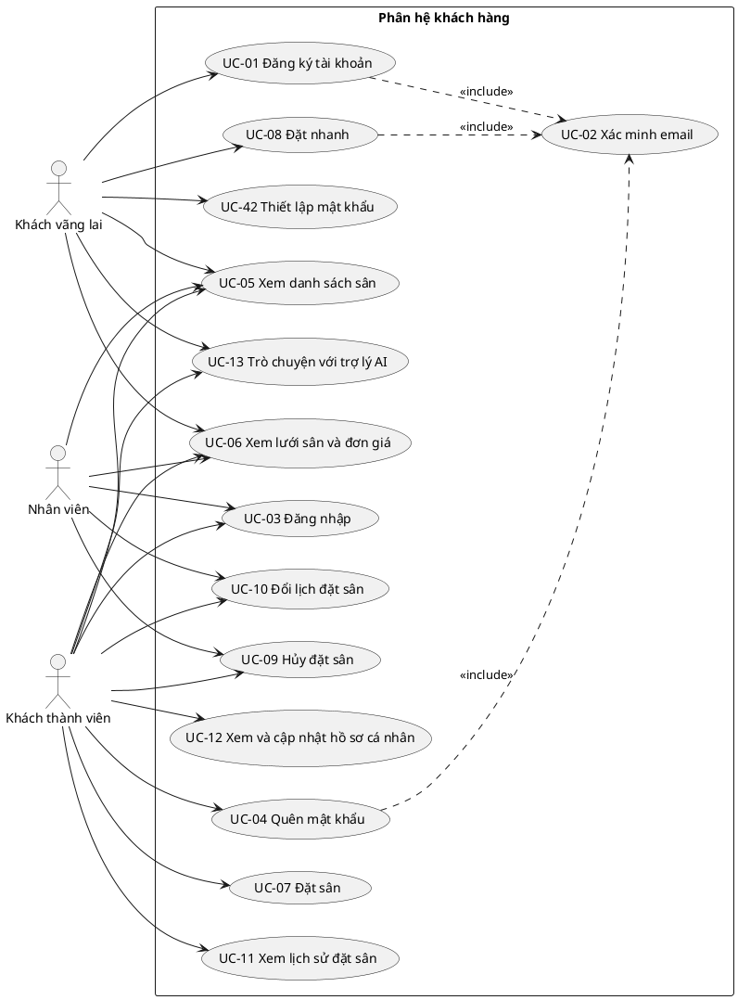

### 1.2 Phân hệ nhân viên

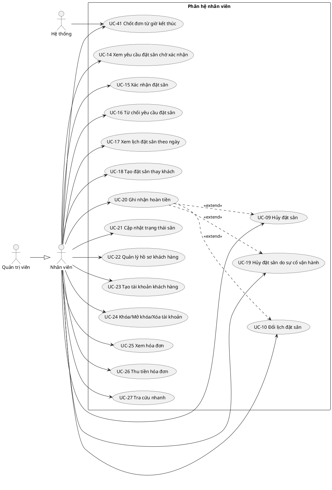

### 1.3 Phân hệ quản trị viên

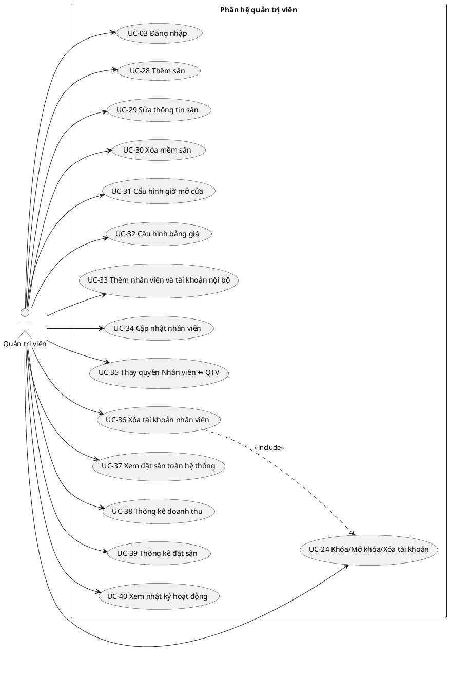

### 1.4 Tổng hợp Actor

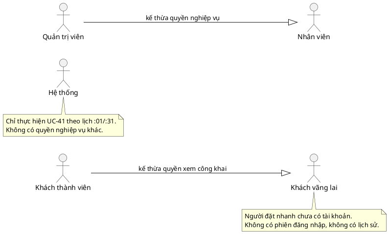

---

## 2. Sơ đồ trạng thái đơn đặt sân

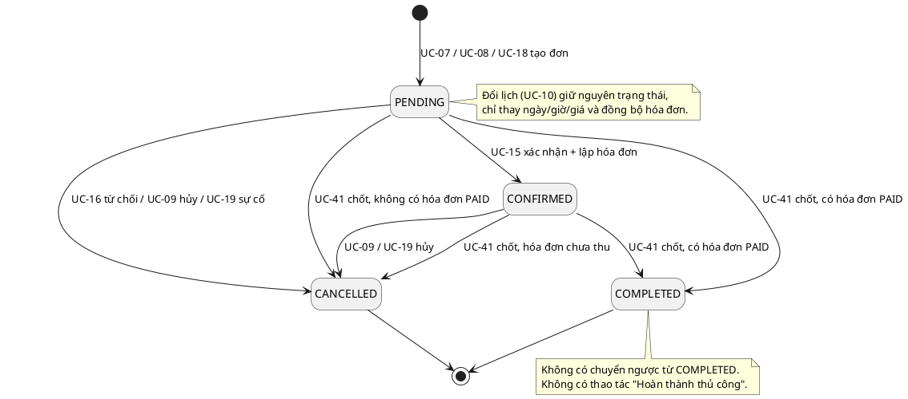

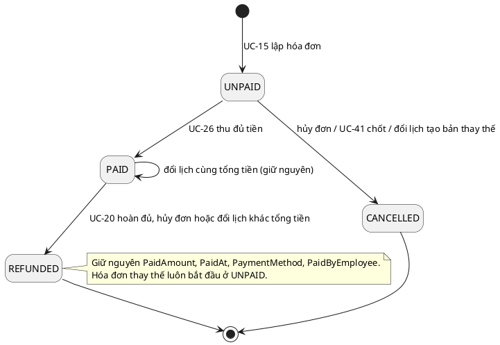

---

## 3. Activity diagram từng use case

### UC-01 Đăng ký tài khoản

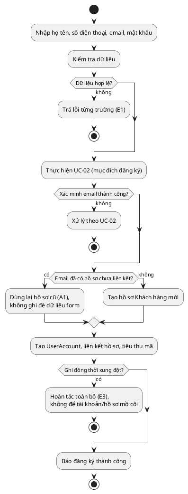

### UC-02 Xác minh email

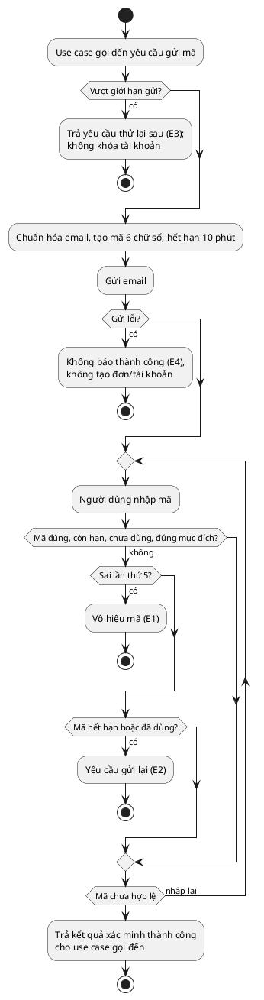

### UC-03 Đăng nhập

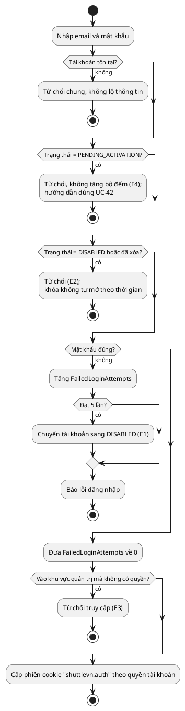

### UC-04 Quên mật khẩu

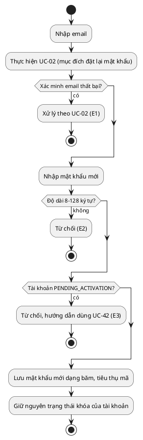

### UC-05 Xem danh sách sân

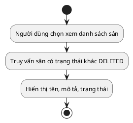

### UC-06 Xem lưới sân và đơn giá

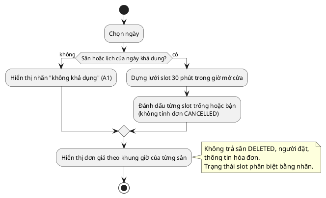

### UC-07 Đặt sân

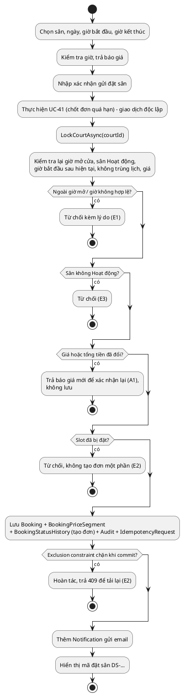

### UC-08 Đặt nhanh

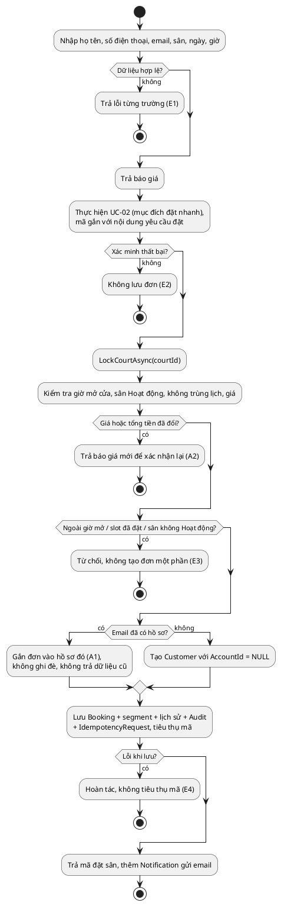

### UC-09 Hủy đặt sân

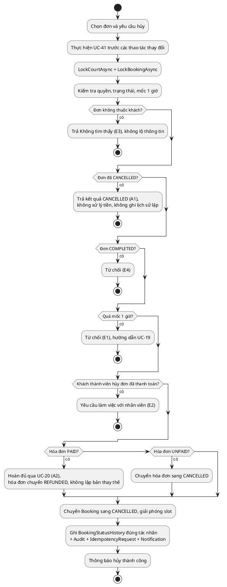

### UC-10 Đổi lịch đặt sân

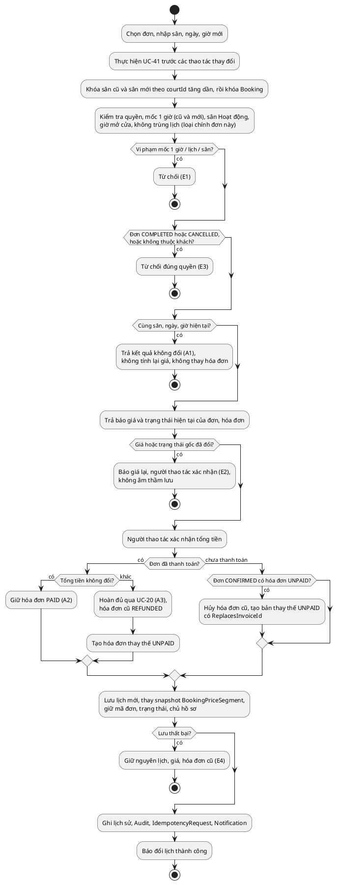

### UC-11 Xem lịch sử đặt sân

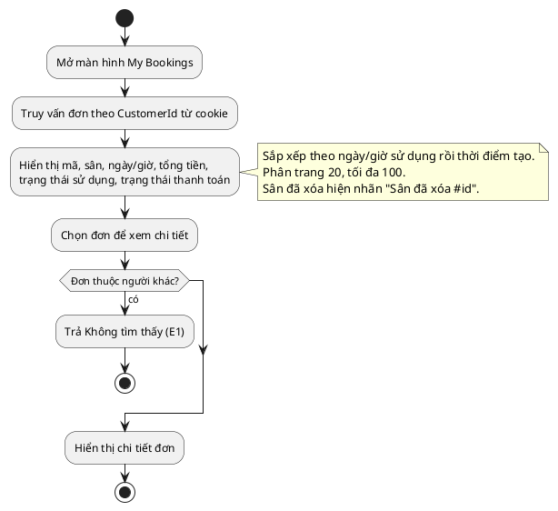

### UC-12 Xem và cập nhật hồ sơ cá nhân

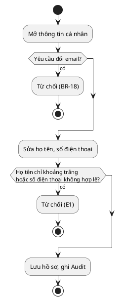

### UC-13 Trò chuyện với trợ lý AI

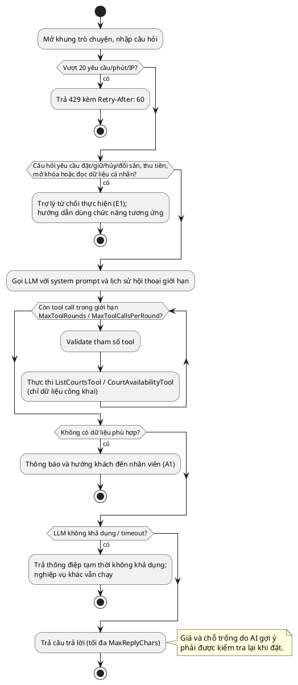

### UC-14 Xem yêu cầu đặt sân chờ xác nhận

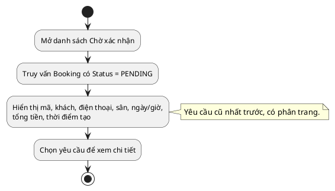

### UC-15 Xác nhận đặt sân

```plantuml
@startuml UC-15
start
:Chọn đơn PENDING từ UC-14;
:Thực hiện UC-41 trước các thao tác thay đổi;
:LockCourtAsync + LockBookingAsync;
:Kiểm tra trạng thái, giờ bắt đầu, sân và lịch, không trùng lịch;
if (Đã đến hoặc qua giờ bắt đầu?) then (có)
  :Từ chối (E1);\nchỉ thu hóa đơn hợp lệ trước giờ kết thúc (UC-26)\nhoặc xử lý sự cố (UC-19);
  stop
endif
if (Sân không Hoạt động hoặc lịch không khả dụng?) then (có)
  :Từ chối (E2);
  stop
endif
if (Trùng lịch?) then (có)
  :Từ chối (E3);
  stop
endif
if (Đơn đã CONFIRMED?) then (có)
  :Trả kết quả hiện có (A2),\nkhông lập thêm hóa đơn hay lịch sử;
  stop
endif
if (Đơn CANCELLED hoặc COMPLETED?) then (có)
  :Từ chối (E4);
  stop
endif
if (Khách đã trả đủ ngay?) then (có)
  :Cấp số hóa đơn, tạo Invoice PAID (A1)\nvới PaidAmount = TotalCost, phương thức,\nthời điểm thực thu, người thu;
else (không)
  :Cấp số hóa đơn, tạo Invoice UNPAID\nmã HD-yyyyMMdd-n, TotalCost = giá đơn;
endif
:Chuyển Booking sang CONFIRMED;
:Ghi BookingStatusHistory + Audit\n+ IdempotencyRequest + Notification;
:Báo xác nhận thành công;
stop
@enduml
```

### UC-16 Từ chối yêu cầu đặt sân

```plantuml
@startuml UC-16
start
:Chọn đơn PENDING;
:Thực hiện UC-41 trước các thao tác thay đổi;
:Nhập lý do từ chối;
if (Không nhập lý do?) then (có)
  :Từ chối thao tác (E1);
  stop
endif
:LockBookingAsync;
if (Đơn đã CONFIRMED?) then (có)
  :Không dùng thao tác từ chối (E2),\nhướng dẫn UC-09 hoặc UC-19;
  stop
endif
:Chuyển Booking sang CANCELLED, giải phóng slot;
:Không lập hóa đơn;
:Ghi lịch sử kèm lý do + Audit\n+ IdempotencyRequest + Notification;
:Báo từ chối thành công;
stop
@enduml
```

### UC-17 Xem lịch đặt sân theo ngày

```plantuml
@startuml UC-17
start
:Chọn ngày và (tùy chọn) lọc theo sân;
:Truy vấn đơn theo ngày, bỏ đơn CANCELLED;
:Dựng lưới gồm cả slot trống;
:Hiển thị lưới đặt sân;
stop
@enduml
```

### UC-18 Tạo đặt sân thay khách

```plantuml
@startuml UC-18
start
:Nhập họ tên, số điện thoại, email của khách\nvà sân, ngày, giờ;
if (Dữ liệu khách không hợp lệ?) then (có)
  :Nêu trường lỗi (E2);
  stop
endif
if (Email đã có hồ sơ?) then (có)
  :Dùng lại hồ sơ;
else (không)
  :Tạo Customer mới (AccountId = NULL);
endif
:Thực hiện UC-41 trước các thao tác thay đổi;
:LockCourtAsync(courtId);
:Kiểm tra giờ, trả báo giá, nhân viên xác nhận;
:Kiểm tra lại giờ mở cửa, sân Hoạt động, không trùng lịch, giá;
if (Giá hoặc tổng tiền đã đổi?) then (có)
  :Trả báo giá mới để xác nhận lại (A1);
  stop
endif
if (Ngoài giờ / trùng lịch / sân không Hoạt động?) then (có)
  :Từ chối, không tạo đơn một phần (E1);
  stop
endif
:Lưu đơn PENDING, lịch sử ghi tác nhân Nhân viên,\nAudit, IdempotencyRequest;
:Trả mã đặt sân, thêm Notification;
stop
@enduml
```

### UC-19 Hủy đặt sân do sự cố vận hành

```plantuml
@startuml UC-19
start
:Chọn đơn, nhập lý do sự cố,\nxác nhận khách chưa sử dụng lượt sân;
if (Không có lý do sự cố?) then (có)
  :Từ chối (E1);
  stop
endif
if (Khách đã sử dụng lượt sân?) then (có)
  :Không hủy để xóa lượt sử dụng (E2),\ntheo chốt của UC-41;
  stop
endif
:Thực hiện UC-41 trước các thao tác thay đổi;
:LockCourtAsync + LockBookingAsync;
if (Đơn đã ở trạng thái cuối?) then (có)
  :Từ chối (E3);
  stop
endif
if (Hóa đơn PAID?) then (có)
  :Hoàn đủ qua UC-20 (A1),\nhóa đơn REFUNDED, không lập bản thay thế;
elseif (Hóa đơn UNPAID?) then (có)
  :Chuyển hóa đơn sang CANCELLED;
endif
:Chuyển Booking sang CANCELLED (không giới hạn mốc 1 giờ);
:Ghi lịch sử lý do sự cố + Audit\n+ IdempotencyRequest + Notification;
:Thông báo cho khách;
stop
@enduml
```

### UC-20 Ghi nhận hoàn tiền

```plantuml
@startuml UC-20
start
note right
  Được gọi từ UC-09, UC-10, UC-19
  khi hóa đơn PAID và đơn bị hủy
  hoặc đổi lịch khác tổng tiền.
end note
:Xác định cần hoàn tiền, hiển thị số tiền cần hoàn;
:Nhân viên hoàn tiền ngoài hệ thống;
if (Yêu cầu hoàn một phần?) then (có)
  :Không hỗ trợ (E2);
  stop
endif
:Nhập số tiền, phương thức, thời điểm thực hoàn, lý do;
:Đối chiếu trạng thái hiện tại dưới khóa;
if (Đối chiếu thất bại sau khi đã chuyển tiền?) then (có)
  :Chỉ thử lại bước ghi nhận bằng chứng cứ cũ (A1),\nkhông yêu cầu chuyển tiền lần nữa;\nchuyển nhân viên xử lý;
  stop
endif
if (Chưa hoàn tất xử lý tiền?) then (có)
  :Giữ nguyên dữ liệu của thao tác hủy/đổi (E1);
  stop
endif
:Lưu RefundAmount = TotalCost, RefundMethod,\nRefundedAt, RefundedByEmployee, RefundReason;
:Chuyển hóa đơn cũ sang REFUNDED, giữ PaidAmount và chứng cứ thu;
if (Đổi lịch khác tổng tiền?) then (có)
  :Tạo hóa đơn thay thế UNPAID;
endif
:Ghi Audit + IdempotencyRequest cùng giao dịch hủy/đổi;
stop
@enduml
```

### UC-21 Cập nhật trạng thái sân

```plantuml
@startuml UC-21
start
:Chọn sân và trạng thái mới;
if (Chọn trạng thái DELETED?) then (có)
  :Không cho phép (E2), chỉ qua UC-30;
  stop
endif
:LockCourtAsync(courtId);
if (Chuyển sang MAINTENANCE hoặc CLOSED\nvà còn đơn PENDING/CONFIRMED?) then (có)
  :Từ chối (E1),\nxử lý trước bằng UC-09/UC-10/UC-16/UC-19;
  stop
endif
:Lưu trạng thái sân, ghi Audit;
:Trả kết quả;
stop
@enduml
```

### UC-22 Quản lý hồ sơ khách hàng

```plantuml
@startuml UC-22
start
:Mở danh sách khách,\ntìm theo họ tên, số điện thoại hoặc email;
:Chọn khách để xem hồ sơ và các đặt sân;
:Sửa thông tin khách;
if (Yêu cầu đổi email?) then (có)
  :Từ chối (E2, BR-18);
  stop
endif
if (Dữ liệu không hợp lệ?) then (có)
  :Nêu trường lỗi (E1);
  stop
endif
:Lưu hồ sơ, ghi Audit;
stop
@enduml
```

### UC-23 Tạo tài khoản khách hàng

```plantuml
@startuml UC-23
start
:Nhập họ tên, số điện thoại, email;
if (Dữ liệu không hợp lệ?) then (có)
  :Nêu trường lỗi (E1);
  stop
endif
if (Email đã là email đăng nhập\nhoặc hồ sơ đã có tài khoản?) then (có)
  :Từ chối (E2);
  stop
endif
if (Email đã có hồ sơ chưa liên kết?) then (có)
  :Dùng lại hồ sơ;
else (không)
  :Tạo hồ sơ mới;
endif
:Tạo UserAccount PENDING_ACTIVATION, passwordHash rỗng,\nliên kết hồ sơ;
:Tạo mã SET_PASSWORD hiệu lực 24 giờ, gửi email liên kết;
if (Gửi email lỗi?) then (có)
  :Hoàn tác toàn bộ (E4),\nkhông tạo tài khoản, không báo thành công;
  stop
endif
if (Ghi đồng thời xung đột?) then (có)
  :Hoàn tác, không để tài khoản/hồ sơ mồ côi (E3);
  stop
endif
:Trả kết quả tạo tài khoản;
stop
@enduml
```

### UC-24 Khóa/Mở khóa/Xóa tài khoản

```plantuml
@startuml UC-24
start
:Chọn tài khoản và thao tác;
:Kiểm tra phạm vi quyền;
if (Nhân viên thao tác tài khoản nội bộ\nhoặc yêu cầu xóa?) then (có)
  :Từ chối (E1), chỉ QTV được xóa;
  stop
endif
if (Tài khoản PENDING_ACTIVATION?) then (có)
  :Từ chối khóa/mở khóa (E4);
  stop
endif
if (Thao tác làm mất QTV ACTIVE cuối cùng?) then (có)
  :Từ chối (E2);
  stop
endif
if (Thao tác = Khóa?) then (có)
  :Chuyển tài khoản sang DISABLED;
  :Ghi Audit;
  stop
endif
if (Thao tác = Mở khóa?) then (có)
  :Chuyển ACTIVE, đưa FailedLoginAttempts về 0;
  :Ghi Audit;
  stop
endif
if (Thao tác = Xóa?) then (có)
  :Vô hiệu mã xác minh theo loginEmail;
  :Xóa UserAccount, FK SET NULL đưa accountId hồ sơ về NULL;
  :Giữ hồ sơ, đặt sân, hóa đơn, nhật ký;
  :Ghi Audit với entityId = accountId đã xóa;
  stop
endif
:Từ chối thao tác không hợp lệ;
stop
@enduml
```

### UC-25 Xem hóa đơn

```plantuml
@startuml UC-25
start
:Mở danh sách hóa đơn có phân trang,\nlọc UNPAID/PAID/CANCELLED/REFUNDED hoặc tìm theo mã;
:Chọn hóa đơn;
:Hiển thị chi tiết hóa đơn;
:Hiển thị hóa đơn tiền nhiệm hoặc thay thế;
:Hiển thị chứng cứ thu, hoàn, hủy gồm số tiền,\nphương thức, thời điểm thực tế, lý do, tác nhân;
stop
@enduml
```

### UC-26 Thu tiền hóa đơn

```plantuml
@startuml UC-26
start
:Chọn hóa đơn UNPAID;
:Thực hiện UC-41 trước các thao tác thay đổi;
:LockBookingAsync rồi khóa Invoice (thứ tự cố định);
if (Đơn vừa bị chốt CANCELLED?) then (có)
  :Không nhận thanh toán (E3);\nkết quả chốt không bị hoàn tác;
  stop
endif
if (Đơn CANCELLED hoặc hóa đơn CANCELLED/REFUNDED?) then (có)
  :Từ chối (E1);
  stop
endif
if (Thu lặp cùng hóa đơn và cùng nội dung?) then (có)
  :Trả kết quả cũ (A1),\nkhông đổi chứng cứ hay thời điểm;
  stop
endif
if (Thu lặp khác nội dung hoặc ExpectedState đã đổi?) then (có)
  :Từ chối, tải lại (E2);
  stop
endif
:Nhập số tiền, phương thức, thời điểm thực thu, xác nhận;
if (Số tiền khác TotalCost, thu một phần,\nhoặc thiếu chứng cứ?) then (có)
  :Từ chối (E4);
  stop
endif
:Invoice.Status = PAID, PaidAmount = TotalCost,\nPaidAt, PaymentMethod, PaidByEmployee;
note right
  Không tự chuyển Booking sang COMPLETED.
end note
:Ghi Audit + IdempotencyRequest + Notification;
:Thông báo thu tiền thành công;
stop
@enduml
```

### UC-27 Tra cứu nhanh

```plantuml
@startuml UC-27
start
:Nhập số điện thoại, email hoặc mã đặt sân;
:Truy vấn khách hàng và các đặt sân liên quan;
if (Không có kết quả?) then (có)
  :Thông báo không tìm thấy (E1);
  stop
endif
:Hiển thị khách hàng và đặt sân kèm trạng thái;
:Mở chi tiết đặt sân;
stop
@enduml
```

### UC-28 Thêm sân

```plantuml
@startuml UC-28
start
:Nhập tên, mô tả, trạng thái,\ngiờ mở/đóng mặc định, đơn giá mặc định;
if (Tên trống hoặc trùng tên sân chưa xóa?) then (có)
  :Từ chối (E1);
  stop
endif
if (Giờ không hợp lệ hoặc đơn giá <= 0?) then (có)
  :Từ chối (E2);
  stop
endif
:Hiển thị xem trước cấu hình kết quả;
if (QTV không xác nhận?) then (có)
  stop
endif
:Tạo BadmintonCourt + 7 CourtSchedule + 7 PricingRule\ntrong một giao dịch, ghi Audit;
if (Lỗi ở bất kỳ bước nào?) then (có)
  :Hoàn tác, không để sân thiếu giá (E3);
  stop
endif
:Trả kết quả;
stop
@enduml
```

### UC-29 Sửa thông tin sân

```plantuml
@startuml UC-29
start
:Chọn sân;
if (Sân DELETED?) then (có)
  :Không cho sửa (E2);
  stop
endif
:Sửa tên, mô tả;
if (Tên trống hoặc trùng tên sân chưa xóa khác?) then (có)
  :Từ chối (E1);
  stop
endif
:Lưu thông tin sân, ghi Audit với giá trị trước và sau;
stop
@enduml
```

### UC-30 Xóa mềm sân

```plantuml
@startuml UC-30
start
:Chọn sân và yêu cầu xóa;
:LockCourtAsync(courtId);
if (Sân đã DELETED?) then (có)
  :Trả kết quả DELETED (A1),\nkhông ghi thêm nhật ký;
  stop
endif
if (Còn đơn PENDING hoặc CONFIRMED?) then (có)
  :Từ chối (E1);
  stop
endif
:Chuyển sân sang DELETED, đặt Name = NULL;
:Ghi Audit lưu tên cũ;
if (Xung đột với việc tạo/đổi/xác nhận đơn đồng thời?) then (có)
  :Hoàn tác, tải lại (E2);
  stop
endif
:Giữ mã sân, lịch, giá và giao dịch cũ;
stop
@enduml
```

### UC-31 Cấu hình giờ mở cửa

```plantuml
@startuml UC-31
start
:Chọn sân, ngày trong tuần;\nnhập giờ mở, giờ đóng, khả dụng;
if (Sân DELETED?) then (có)
  :Từ chối;
  stop
endif
if (Giờ không hợp lệ?) then (có)
  :Từ chối (E3);
  stop
endif
:LockCourtAsync + khóa lịch tương ứng;
:Kiểm tra thay đổi không làm đơn PENDING/CONFIRMED\nnằm ngoài giờ mở hoặc không khả dụng;
if (Vi phạm?) then (có)
  :Từ chối (E1);
  stop
endif
if (Thay đổi trong ngày hiện tại loại khỏi giờ mở\ncác lượt COMPLETED đã ghi nhận?) then (có)
  :Từ chối (E2);
  stop
endif
if (Mở rộng giờ hoặc không ảnh hưởng đơn trên?) then (có)
  :Được phép (A1);
endif
:Xem trước điều chỉnh bảng giá\n(bỏ mốc ngoài khoảng mới, thêm mốc tại giờ mở mới);
:Lưu lịch và giá trong một giao dịch, ghi Audit;
stop
@enduml
```

### UC-32 Cấu hình bảng giá

```plantuml
@startuml UC-32
start
:Chọn sân, ngày trong tuần;\nnhập danh sách mốc giờ và đơn giá;
if (Sân DELETED?) then (có)
  :Từ chối;
  stop
endif
:LockCourtAsync + khóa lịch tương ứng;
:Kiểm tra toàn bộ bảng giá:\nkhông rỗng, mốc đầu = giờ mở, mọi mốc trong [OpenTime, CloseTime),\nmốc tăng dần, đơn giá > 0;
if (Bảng giá không hợp lệ hoặc rỗng?) then (có)
  :Từ chối, không tự sửa (E1);
  stop
endif
:Thay toàn bộ bảng giá hiện hành của ngày trong tuần,\nghi Audit;
note right
  TotalCost và segment đã lưu trên Booking cũ
  không đổi.
end note
stop
@enduml
```

### UC-33 Thêm nhân viên và tài khoản nội bộ

```plantuml
@startuml UC-33
start
:Nhập họ tên, số điện thoại, email, quyền quản trị;
if (Dữ liệu không hợp lệ?) then (có)
  :Nêu trường lỗi (E1);
  stop
endif
if (Email đã là email đăng nhập của tài khoản khác?) then (có)
  :Từ chối (E2);
  stop
endif
:Tạo UserAccount và Employee liên kết một-một\ntrong cùng giao dịch;
:Đồng bộ email hồ sơ với loginEmail, ghi Audit;
if (Ghi đồng thời xung đột?) then (có)
  :Hoàn tác, không để tài khoản/hồ sơ mồ côi (E3);
  stop
endif
:Trả kết quả;
stop
@enduml
```

### UC-34 Cập nhật nhân viên

```plantuml
@startuml UC-34
start
:Chọn nhân viên;
:Sửa họ tên, số điện thoại;
if (Yêu cầu đổi email?) then (có)
  :Từ chối (E1, BR-18);
  stop
endif
if (Dữ liệu không hợp lệ?) then (có)
  :Nêu trường lỗi (E2);
  stop
endif
:Cập nhật hồ sơ, ghi Audit;
stop
@enduml
```

### UC-35 Thay quyền Nhân viên ↔ QTV

```plantuml
@startuml UC-35
start
:Chọn hồ sơ Nhân viên và quyền mới;
if (Yêu cầu chuyển loại hồ sơ\nKhách hàng ↔ Nhân viên?) then (có)
  :Không cho phép (E2);
  stop
endif
if (Hạ quyền QTV ACTIVE cuối cùng?) then (có)
  :Từ chối (E1);
  stop
endif
:Cập nhật quyền trên hồ sơ, ghi Audit;
:Quyền mới có hiệu lực khi kiểm tra phía máy chủ;
stop
@enduml
```

### UC-36 Xóa tài khoản nhân viên

```plantuml
@startuml UC-36
start
:Chọn nhân viên và yêu cầu xóa tài khoản;
if (Là QTV ACTIVE cuối cùng?) then (có)
  :Từ chối (E1);
  stop
endif
:Thực hiện nhánh Xóa của UC-24;
:Xóa UserAccount, giữ hồ sơ Employee;
:Giữ mã nhân viên và các liên kết lịch sử\n(ChangedByEmployee, IssuedByEmployee, Audit);
:Ghi Audit trong cùng giao dịch;
stop
@enduml
```

### UC-37 Xem đặt sân toàn hệ thống

```plantuml
@startuml UC-37
start
:Mở danh sách đặt sân, chọn bộ lọc;
if (Từ ngày > đến ngày?) then (có)
  :Từ chối (E1);
  stop
endif
:Truy vấn đặt sân toàn hệ thống, có phân trang;
:Hiển thị danh sách;
:Chọn đơn để xem chi tiết kèm lịch sử trạng thái;
stop
@enduml
```

### UC-38 Thống kê doanh thu

```plantuml
@startuml UC-38
start
:Chọn khoảng thời gian;
if (Từ ngày > đến ngày?) then (có)
  :Từ chối (E1);
  stop
endif
:Đổi khoảng ngày Việt Nam sang [start, end) UTC;
:Cộng TotalCost của hóa đơn hợp lệ PAID\ntheo PaidAt trong khoảng;
note right
  Loại CANCELLED, REFUNDED
  và hóa đơn UNPAID.
end note
:Hiển thị tổng doanh thu và phân theo ngày hoặc tháng\ndạng bảng và biểu đồ;
stop
@enduml
```

### UC-39 Thống kê đặt sân

```plantuml
@startuml UC-39
start
:Chọn khoảng ngày sử dụng;
if (Từ ngày > đến ngày?) then (có)
  :Từ chối (E1);
  stop
endif
:Đếm lượt và tính giờ đã đặt\n(mọi trạng thái trừ CANCELLED);
:Tách riêng lượt và giờ COMPLETED;
note right
  Giữ giao dịch của sân đã xóa,
  nhãn "Sân đã xóa #id".
end note
:Hiển thị kết quả;
stop
@enduml
```

### UC-40 Xem nhật ký hoạt động

```plantuml
@startuml UC-40
start
:Mở nhật ký;
if (Từ ngày > đến ngày?) then (có)
  :Từ chối (E1);
  stop
endif
:Hiển thị thời điểm, tác nhân (System/Employee/Customer),\nthao tác, đối tượng, giá trị trước và sau;
:Lọc theo thời gian, tác nhân, đối tượng, thao tác;
note right
  Chỉ đọc. Không có API tạo, sửa
  hay xóa Audit.
end note
stop
@enduml
```

### UC-41 Chốt đơn từ giờ kết thúc

```plantuml
@startuml UC-41
start
:Khởi động dịch vụ nền PendingBookingExpiryService;
repeat
  :Chọn mọi Booking PENDING/CONFIRMED\ncó Date + EndTime <= now (giờ Việt Nam);
  while (Còn đơn cần chốt?)
    :Thực hiện trong giao dịch độc lập:\nkhóa sân rồi khóa đơn;
    if (Đã qua giờ kết thúc? và trạng thái còn PENDING/CONFIRMED?) then (không)
      :Bỏ qua đơn;
    else (có)
      if (Có hóa đơn hợp lệ PAID?) then (có)
        :Booking.Status = COMPLETED, giữ hóa đơn;
      else (không)
        :Booking.Status = CANCELLED;
        if (Có hóa đơn UNPAID?) then (có)
          :Hóa đơn CANCELLED, CancellationActorType = System;
        endif
      endif
      :Ghi BookingStatusHistory với ActorType = System\n+ lý do tự động + Audit;
      :Lưu kết quả và thêm Notification;
    endif
  endwhile
  :Chờ mốc :01 hoặc :31 gần nhất còn ở tương lai (giờ Việt Nam);
repeat while (Dịch vụ còn chạy?)

note right
  Lỗi: thử lại sau 1 phút.
  Chạy lặp không tạo lặp hóa đơn hay lịch sử.
  Giao dịch chốt được giữ kể cả khi
  yêu cầu tiếp theo của người dùng bị từ chối.
end note
stop
@enduml
```

```plantuml
@startuml UC-41-NhanVien
start
note right
  Nhánh nhân viên yêu cầu "Hoàn thành".
  Không có thao tác Hoàn thành thủ công.
end note
:Nhân viên chọn đơn và yêu cầu Hoàn thành;
:Thực hiện UC-41 (giao dịch độc lập);
if (Chưa đến giờ kết thúc?) then (có)
  :Từ chối, đơn giữ nguyên (E3);\nkhông lập hóa đơn, không ghi nhận thu để cứu đơn;
  stop
endif
if (Đơn đã ở trạng thái cuối?) then (có)
  :Trả trạng thái hiện có (E1),\nkhông ghi lặp lịch sử;
  stop
endif
if (Vừa được chốt trong bước trên?) then (có)
  :Lưu kết quả chốt đã commit,\ntrả xung đột để tải lại;\nnhân viên không ghi đè kết quả;
  stop
endif
:Trả trạng thái sau khi chốt;
stop
@enduml
```

### UC-42 Thiết lập mật khẩu

```plantuml
@startuml UC-42
start
:Khách mở liên kết trong email;
if (Liên kết hết hạn hoặc đã bị thay?) then (có)
  :Khách yêu cầu gửi lại (A1);
  :Vô hiệu liên kết cũ, tạo liên kết mới hiệu lực 24 giờ,\ngửi đến email hồ sơ;
  note right
    Phản hồi luôn như nhau dù email có thuộc
    tài khoản PENDING_ACTIVATION hay không.
  end note
  stop
endif
:Nhập mật khẩu mới và xác nhận mật khẩu;
if (Liên kết đúng email, đúng mục đích, còn hạn, chưa dùng? và\nmật khẩu 8–128 ký tự?) then (không)
  :Từ chối, không tiêu thụ liên kết;
  stop
endif
:Lưu mật khẩu dạng băm;
:Chuyển UserAccount PENDING_ACTIVATION sang ACTIVE;
:Tiêu thụ liên kết bằng cập nhật có điều kiện\ntrong cùng giao dịch;
:Giữ nguyên hồ sơ và lịch sử đặt sân;
stop
@enduml
```
